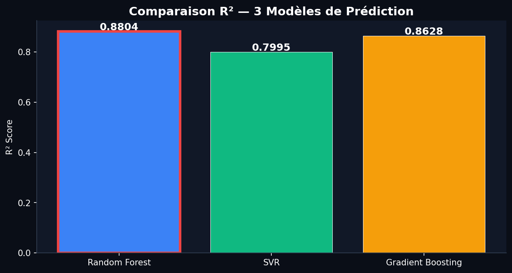
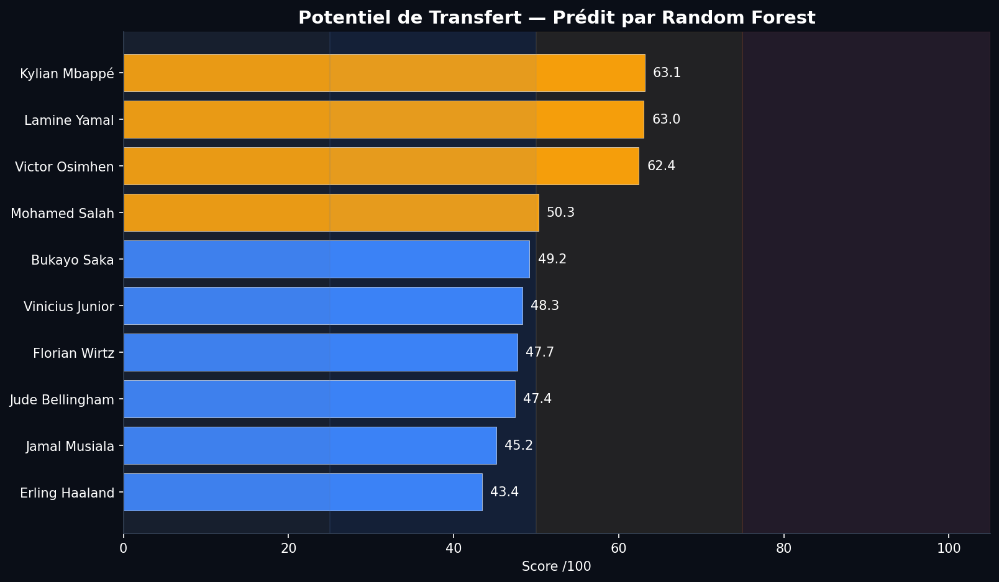
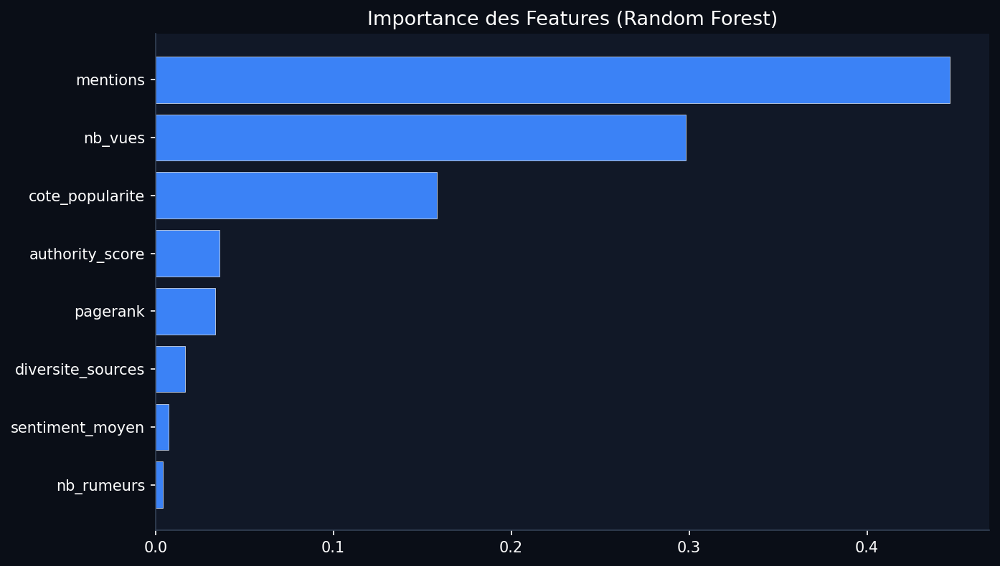

# Scout-AI — Football Transfer Market Intelligence System

> A multi-axis web mining platform for analyzing football player transfer potential using NLP, graph analysis, behavioral clustering, and comparative machine learning.

---

## Table of Contents

1. [Project Overview](#1-project-overview)
2. [Project Objectives](#2-project-objectives)
3. [Main Features](#3-main-features)
4. [System Architecture](#4-system-architecture)
5. [Project Structure](#5-project-structure)
6. [Technologies Used](#6-technologies-used)
7. [Installation](#7-installation)
8. [Environment Configuration](#8-environment-configuration)
9. [Environment Variables](#9-environment-variables)
10. [Usage Instructions](#10-usage-instructions)
11. [Data Description](#11-data-description)
12. [Machine Learning Models](#12-machine-learning-models)
13. [Pipeline Description](#13-pipeline-description)
14. [Dashboard Description](#14-dashboard-description)
15. [Docker Configuration](#15-docker-configuration)
16. [Figures and Screenshots](#16-figures-and-screenshots)
17. [Dependencies](#17-dependencies)
18. [Security](#18-security)
19. [Limitations](#19-limitations)
20. [Future Improvements](#20-future-improvements)
21. [Documentation](#21-documentation)

---

## 1. Project Overview

**Scout-AI** is a data intelligence system designed to analyze the football transfer market by combining three complementary web mining techniques:

- **Web Content Mining** — collecting and semantically analyzing press articles and player statistics
- **Web Structure Mining** — modeling the relational network of players, clubs, agents, and media
- **Web Usage Mining** — analyzing behavioral patterns of fans and scouts consulting player profiles

The system produces a **Transfer Potential Score** for the 10 most prominent players in European football, ranked using a comparative machine learning pipeline (Random Forest, SVR, Gradient Boosting).

Results are visualized in an interactive **Streamlit dashboard** connected to three NoSQL databases: MongoDB, Neo4J, and ElasticSearch.

---

## 2. Project Objectives

- Build a complete end-to-end web mining pipeline covering data collection, enrichment, storage, and analysis.
- Apply NLP (Named Entity Recognition + Sentiment Analysis via BERT) to press articles.
- Construct a relational graph of the football ecosystem and apply graph algorithms (HITS, PageRank, Louvain community detection).
- Mine behavioral patterns from web usage logs using Apriori and K-Means clustering.
- Train and compare multiple regression models to predict transfer potential.
- Store all results in a NoSQL architecture (MongoDB, Neo4J, ElasticSearch).
- Provide an interactive dashboard for result exploration.

---

## 3. Main Features

| Feature | Description |
|---------|-------------|
| **NewsAPI Collection** | Automatic article collection for 10 target players in French and English |
| **Football-Data API** | League standings, top scorers, and recent match results for 5 major leagues |
| **Transfermarkt Scraping** | Ethical scraping of player market values and transfer histories |
| **BERT NLP Pipeline** | Named Entity Recognition (CamemBERT) + Sentiment Analysis (multilingual BERT) |
| **Popularity Score** | Composite score: 0.4 × mentions + 0.35 × sentiment + 0.25 × source diversity |
| **Relational Graph** | NetworkX directed graph: players, clubs, agents, leagues, media |
| **HITS Algorithm** | Hub and Authority scores for rumor network analysis |
| **PageRank** | Node importance ranking across the football ecosystem graph |
| **Louvain Clustering** | Community detection in the relational network |
| **Neo4J Export** | Full graph exportable to Neo4J with generated Cypher script |
| **Google Trends** | Search trend collection per player (3-month window) |
| **Web Usage Simulation** | Realistic web log simulation for 500 users / 2000 sessions |
| **Apriori Mining** | Frequent page navigation pattern discovery |
| **K-Means Segmentation** | Audience clustering: Bettor / Fan / Curious profiles |
| **ML Pipeline** | Random Forest vs SVR vs Gradient Boosting comparison by R² score |
| **Transfer Potential** | Final ranking of 10 real players (0–100 score, 4 categories) |
| **Streamlit Dashboard** | 6-tab interactive dashboard with Plotly visualizations |
| **NoSQL Storage** | MongoDB + Neo4J + ElasticSearch integration via Docker |

---

## 4. System Architecture

```
┌─── DATA COLLECTION LAYER ────────────────────────────────────────────┐
│                                                                        │
│  Axe 1 — Content Mining    Axe 2 — Structure Mining   Axe 3 — Usage  │
│  • NewsAPI                 • NetworkX Graph            • Google Trends │
│  • Football-Data API       • HITS + PageRank           • Log Simulation│
│  • Transfermarkt Scraping  • Louvain Communities       • Apriori       │
│  • BERT NER + Sentiment    • Neo4J Export              • K-Means       │
└──────────────────────────────┬───────────────────────────────────────┘
                               │ data/ (JSON + CSV)
┌──────────────────────────────▼───────────────────────────────────────┐
│  STORAGE LAYER (Docker)                                                │
│  MongoDB (documents) · Neo4J (graph) · ElasticSearch (full-text)      │
└──────────────────────────────┬───────────────────────────────────────┘
                               │
┌──────────────────────────────▼───────────────────────────────────────┐
│  ML PIPELINE — pipeline_ia.py                                          │
│  Random Forest vs SVR vs Gradient Boosting → best model → models/     │
└──────────────────────────────┬───────────────────────────────────────┘
                               │
┌──────────────────────────────▼───────────────────────────────────────┐
│  DASHBOARD — dashboard_streamlit.py                                    │
│  6 tabs · Plotly charts · DB-connected with JSON fallback              │
└───────────────────────────────────────────────────────────────────────┘
```

---

## 5. Project Structure

```
scout-ai/
│
├── .env.example                    ← Environment variable template (copy → .env)
├── .gitignore                      ← Git exclusions (secrets, cache, large files)
├── requirements.txt                ← Python dependencies
├── docker-compose.yml              ← MongoDB + Neo4J + ElasticSearch containers
│
├── main.py                         ← Data collection entry point
├── pipeline_ia.py                  ← Comparative ML pipeline
├── run_all.py                      ← Full end-to-end orchestration
├── setup_docker.py                 ← Docker database manager
├── dashboard_streamlit.py          ← Interactive Streamlit dashboard
│
├── config/
│   ├── __init__.py
│   └── settings.py                 ← Centralized configuration (env vars)
│
├── collectors/
│   ├── __init__.py
│   ├── axe1_content_mining.py      ← Axe 1: NewsAPI + Transfermarkt + BERT NLP
│   ├── axe2_structure_mining.py    ← Axe 2: Graph + HITS + PageRank + Louvain
│   └── axe3_usage_mining.py        ← Axe 3: Trends + Apriori + K-Means
│
├── database/
│   ├── __init__.py
│   ├── mongo_manager.py            ← MongoDB manager
│   ├── neo4j_manager.py            ← Neo4J manager
│   ├── elastic_manager.py          ← ElasticSearch manager
│   └── setup_databases.py          ← Orchestrates all three databases
│
├── utils/
│   ├── __init__.py
│   └── helpers.py                  ← Ethical scraping, data cleaning, logging, export
│
├── data/                           ← Generated data outputs (JSON + CSV)
│   ├── axe1_articles_bruts.json
│   ├── axe1_articles_enrichis.json
│   ├── axe1_classements.json
│   ├── axe1_buteurs.json
│   ├── axe1_matchs.json
│   ├── axe1_profils_transfermarkt.json
│   ├── axe1_cotes_popularite.json
│   ├── axe2_graphe.json
│   ├── axe2_centralite.json / .csv
│   ├── axe2_hits.json
│   ├── axe2_communautes.json
│   ├── axe2_import_neo4j.cypher
│   ├── axe3_web_logs.csv
│   ├── axe3_patterns.json
│   ├── axe3_clusters.json
│   ├── axe3_fan_values.csv
│   ├── axe3_trends.json
│   ├── ia_transfer_predictions.json
│   └── ia_best_models.json
│
├── models/                         ← Trained ML artifacts
│   ├── best_transfer_model.joblib
│   ├── transfer_scaler.joblib
│   └── transfer_feature_cols.joblib
│
├── figures/                        ← ML visualization outputs (PNG)
│   ├── ia_model_comparison.png
│   ├── ia_transfer_ranking.png
│   └── ia_feature_importance.png
│
└── docs/                           ← Project documentation
    ├── README.md
    ├── architecture/
    │   └── system_architecture.md
    ├── setup/
    │   ├── api_setup.md
    │   └── docker_setup.md
    └── presentations/              ← LOCAL ONLY — not in Git (size > 50 MB)
```

---

## 6. Technologies Used

| Category | Technology | Purpose |
|----------|-----------|---------|
| Language | Python 3.10+ | Core runtime |
| NLP | 🤗 Transformers (BERT, CamemBERT) | NER + Sentiment Analysis |
| NLP | spaCy, NLTK, TextBlob | Text preprocessing |
| Graph | NetworkX | Graph construction and algorithms |
| Graph | python-louvain | Community detection |
| ML | scikit-learn | Random Forest, SVM, Gradient Boosting |
| ML | mlxtend | Apriori / Association Rules |
| Data | pandas, numpy | Data processing |
| Visualization | Plotly, matplotlib, seaborn | Charts and figures |
| Dashboard | Streamlit | Interactive web dashboard |
| Database | MongoDB 7.0 | Document storage |
| Database | Neo4J 5 Community | Graph database |
| Database | ElasticSearch 8.12 | Full-text search |
| Infrastructure | Docker + Docker Compose | Database orchestration |
| Scraping | requests, BeautifulSoup4, Selenium | Web data collection |
| Trends | pytrends | Google Trends API wrapper |
| Config | python-dotenv | Environment variable management |

---

## 7. Installation

### Requirements

- Python 3.10 or higher
- pip
- Docker Desktop (for database features only)

### Steps

```bash
# 1. Clone the repository
git clone https://github.com/your-username/scout-ai.git
cd scout-ai

# 2. Create a virtual environment
python -m venv .venv
source .venv/bin/activate        # Linux/macOS
.venv\Scripts\activate           # Windows

# 3. Install dependencies
pip install -r requirements.txt

# 4. Download the French spaCy model (if running Axe 1 NLP)
python -m spacy download fr_core_news_md

# 5. Configure environment variables
cp .env.example .env
# Edit .env with your API keys (see Section 8)
```

---

## 8. Environment Configuration

Copy the template and fill in your values:

```bash
cp .env.example .env
```

Then edit `.env`:

```bash
# API keys (required for live data collection)
FOOTBALL_DATA_API_KEY=your_key_here
NEWS_API_KEY=your_key_here

# Database connections (defaults work with docker-compose.yml)
MONGO_URI=mongodb://localhost:27017
NEO4J_URI=bolt://localhost:7687
NEO4J_USER=neo4j
NEO4J_PASSWORD=
ELASTIC_HOST=http://localhost:9200
```

See [`docs/setup/api_setup.md`](docs/setup/api_setup.md) for instructions on obtaining API keys.

> **Never commit your `.env` file.** It is already excluded by `.gitignore`.

---

## 9. Environment Variables

| Variable | Required | Default | Description |
|----------|----------|---------|-------------|
| `FOOTBALL_DATA_API_KEY` | For live data | — | Football-Data.org API key |
| `NEWS_API_KEY` | For live data | — | NewsAPI.org API key |
| `MONGO_URI` | No | `mongodb://localhost:27017` | MongoDB connection string |
| `NEO4J_URI` | No | `bolt://localhost:7687` | Neo4J bolt endpoint |
| `NEO4J_USER` | No | `neo4j` | Neo4J username |
| `NEO4J_PASSWORD` | No | *(empty)* | Neo4J password (blank = no auth) |
| `ELASTIC_HOST` | No | `http://localhost:9200` | ElasticSearch URL |

Without API keys, use `--demo` mode (see below). Database variables default to local Docker container addresses.

---

## 10. Usage Instructions

### Quick Start — Demo Mode (no API keys required)

```bash
# Run everything with simulated data
python run_all.py --demo

# Or step by step:
python main.py --demo                              # 1. Collect data (demo)
python pipeline_ia.py                              # 2. Train ML models
python setup_docker.py                             # 3. Start databases + load data
python -m streamlit run dashboard_streamlit.py     # 4. Launch dashboard
```

### Full Pipeline — Live Data

```bash
# Ensure .env is configured with real API keys
python run_all.py
```

### Individual Collection Axes

```bash
python main.py --axe 1     # Content Mining only (NewsAPI + Transfermarkt + NLP)
python main.py --axe 2     # Structure Mining only (Graph + HITS + PageRank)
python main.py --axe 3     # Usage Mining only (Trends + Apriori + K-Means)
python main.py             # All three axes
```

### run_all.py Options

```bash
python run_all.py --demo           # Use simulated data (no API calls)
python run_all.py --skip-collect   # Skip collection (use existing data/)
python run_all.py --skip-ml        # Skip ML pipeline
python run_all.py --skip-db        # Skip database population
python run_all.py --no-dashboard   # Don't launch dashboard at the end
```

### Dashboard Only

```bash
python -m streamlit run dashboard_streamlit.py
# Open: http://localhost:8501
```

### Database Management

```bash
python setup_docker.py             # Start containers + populate
python setup_docker.py --up        # Start containers only
python setup_docker.py --status    # Check connection status
python setup_docker.py --down      # Stop containers
python setup_docker.py --reset     # Full reset (DELETES ALL DATA)
```

---

## 11. Data Description

All data files are stored in the `data/` directory. They are generated by the collectors
and can be regenerated at any time by running the pipeline.

| File | Axe | Description |
|------|-----|-------------|
| `axe1_articles_bruts.json` | 1 | Raw articles from NewsAPI (10 players × 2 languages) |
| `axe1_articles_enrichis.json` | 1 | Articles enriched with BERT NER and sentiment |
| `axe1_classements.json` | 1 | League standings for 5 major European leagues |
| `axe1_buteurs.json` | 1 | Top scorers per league (top 20) |
| `axe1_matchs.json` | 1 | Last 20 matches per league |
| `axe1_profils_transfermarkt.json` | 1 | Player profiles scraped from Transfermarkt |
| `axe1_cotes_popularite.json` | 1 | Computed popularity scores per player |
| `axe2_graphe.json` | 2 | Full relational graph (nodes + edges) |
| `axe2_centralite.json` / `.csv` | 2 | PageRank, betweenness, closeness, degree per node |
| `axe2_hits.json` | 2 | HITS hub and authority scores |
| `axe2_communautes.json` | 2 | Louvain community assignments |
| `axe2_import_neo4j.cypher` | 2 | Cypher script for manual Neo4J import |
| `axe3_web_logs.csv` | 3 | Simulated navigation logs (500 users, 2000 sessions) |
| `axe3_patterns.json` | 3 | Apriori frequent itemsets and association rules |
| `axe3_clusters.json` | 3 | K-Means cluster profiles (Bettor/Fan/Curious) |
| `axe3_fan_values.csv` | 3 | Fan Value scores per user |
| `axe3_trends.json` | 3 | Google Trends timeseries per player |
| `axe3_player_associations.json` | 3 | Player co-occurrence pairs in sessions |
| `ia_transfer_predictions.json` | ML | Final transfer potential scores (10 players) |
| `ia_best_models.json` | ML | Model comparison metrics and feature importance |

---

## 12. Machine Learning Models

Trained models are stored in `models/` (generated by running `pipeline_ia.py`).

| File | Description |
|------|-------------|
| `best_transfer_model.joblib` | Best-performing regression model (RF / SVR / GBM) |
| `transfer_scaler.joblib` | StandardScaler fitted on training data |
| `transfer_feature_cols.joblib` | Ordered list of feature column names |

### Features Used (8 features)

| Feature | Source | Description |
|---------|--------|-------------|
| `mentions` | Axe 1 | Number of press articles mentioning the player |
| `sentiment_moyen` | Axe 1 | Average sentiment score (1–5 stars) |
| `diversite_sources` | Axe 1 | Number of distinct media sources |
| `cote_popularite` | Axe 1 | Composite popularity score (0–100) |
| `nb_rumeurs` | Axe 2 | Number of transfer rumor edges in the graph |
| `pagerank` | Axe 2 | PageRank centrality score |
| `authority_score` | Axe 2 | HITS authority score |
| `nb_vues` | Axe 3 | Number of profile views in simulated logs |

### Transfer Potential Categories

| Score Range | Category |
|-------------|---------|
| 75–100 | 🔴 Très demandé (High demand) |
| 50–75 | 🟡 En hausse (Rising) |
| 25–50 | 🔵 Sous-évalué (Undervalued) |
| 0–25 | ⚫ Stable |

---

## 13. Pipeline Description

### Collection Pipeline (`main.py`)

```
main.py [--axe N] [--demo]
    ├── Axe 1: NewsCollector → FootballStatsCollector → TransfermarktScraper → NLPPipeline
    ├── Axe 2: FootballGraphBuilder → HITSAnalyzer → CentralityAnalyzer → detect_communities
    └── Axe 3: TrendsCollector → WebUsageSimulator → PatternMiner → AudienceSegmenter
```

### ML Pipeline (`pipeline_ia.py`)

```
pipeline_ia.py
    ├── build_training_data()    ← 100 synthetic players (4 categories × 25)
    ├── load_real_players()      ← 10 real players (features from Axes 1, 2, 3)
    ├── train_and_compare()      ← RF vs SVR vs GBM (5-fold CV + test split)
    ├── predict_real_players()   ← Apply best model to 10 real players
    ├── save_results()           ← Save to models/ + data/
    └── generate_figures()       ← Save PNG charts to figures/
```

### Full Orchestration (`run_all.py`)

```
Step 1: Data collection (main.py)
Step 2: ML pipeline (pipeline_ia.py)
Step 3: Database population (setup_databases.py)
Step 4: Dashboard launch (streamlit run dashboard_streamlit.py)
```

---

## 14. Dashboard Description

The Streamlit dashboard (`dashboard_streamlit.py`) provides 6 interactive tabs.

Launch with:
```bash
python -m streamlit run dashboard_streamlit.py
# Access at: http://localhost:8501
```

### Data Sources

The dashboard connects to databases in priority order:
1. **MongoDB** → articles, statistics, profiles, clusters, patterns
2. **Neo4J** → graph, HITS scores, centrality metrics
3. **ElasticSearch** → full-text search
4. **JSON/CSV fallback** → uses `data/` files if databases are unavailable

### Tabs

| Tab | Content |
|-----|---------|
| **Vue d'ensemble** | KPI cards, sentiment distribution, top media sources, top scorers, ElasticSearch full-text search |
| **Popularité** | Popularity score ranking, sentiment scatter plot, per-player detail |
| **Graphe** | Force-directed relational graph visualization with type/relation filters |
| **HITS & Centralité** | Hub/Authority tables, PageRank ranking, centrality metrics |
| **Segmentation** | K-Means cluster profiles (Bettor/Fan/Curious), Fan Value distribution |
| **Prédictions Mercato** | Transfer potential predictions table and bar chart |

---

## 15. Docker Configuration

The `docker-compose.yml` defines three services:

| Service | Image | Port | Data Volume |
|---------|-------|------|-------------|
| `mongodb` | `mongo:7.0` | 27017 | `mongodb_data` |
| `neo4j` | `neo4j:5-community` | 7474, 7687 | `neo4j_data` |
| `elasticsearch` | `elasticsearch:8.12.0` | 9200 | `elastic_data` |

All containers run without authentication (development mode). For production,
enable security settings in `docker-compose.yml`.

```bash
# Full setup
docker compose up -d
python setup_docker.py --populate

# Neo4J browser
open http://localhost:7474

# ElasticSearch health check
curl http://localhost:9200/_cluster/health
```

See [`docs/setup/docker_setup.md`](docs/setup/docker_setup.md) for full details.

---

## 16. Figures and Screenshots

The following figures are generated by `pipeline_ia.py` and saved to `figures/`:

**Model Comparison (R² Score)**



**Transfer Potential Ranking**



**Feature Importance**



---

## 17. Dependencies

Core dependencies (see `requirements.txt` for full list with version pins):

```
requests, beautifulsoup4, lxml, selenium     # Web scraping
transformers, torch, spacy, nltk             # NLP
networkx, python-louvain                     # Graph analysis
scikit-learn, mlxtend, joblib                # Machine learning
pandas, numpy, plotly, matplotlib            # Data & visualization
streamlit                                    # Dashboard
pymongo, neo4j, elasticsearch==7.17.9        # Database clients
python-dotenv                                # Environment config
pytrends                                     # Google Trends
```

> **Note on ElasticSearch**: The Python client is pinned to `7.17.9` for compatibility
> with existing API call style. The Docker image uses `8.12.0`. See
> [`docs/setup/docker_setup.md`](docs/setup/docker_setup.md) for upgrade instructions.

---

## 18. Security

### API Key Management

- **Never hardcode API keys** in source code.
- All sensitive values are read from environment variables via `.env`.
- `.env` is excluded from Git via `.gitignore`.
- See `.env.example` for the required variable names.

> ⚠️ **Key Rotation Required**: If you received an earlier version of this project
> with API keys visible in `config/settings.py`, those keys are compromised.
> Rotate them immediately:
> - Football-Data: https://www.football-data.org/client/register
> - NewsAPI: https://newsapi.org/account

### Ethical Web Scraping

The `utils/helpers.py` module enforces ethical scraping:

- `robots.txt` is checked before scraping any website.
- Random delays of 1.5–3.0 seconds between requests.
- Exponential backoff on HTTP 429 (rate limited) responses.
- Rotating User-Agent pool.
- Personal data (emails, phone numbers) is anonymized before storage (`anonymize_data()`).
- GDPR compliance: author names from articles are anonymized.

### Database Security

- All Docker containers run without authentication (development mode only).
- For production: enable MongoDB authentication, Neo4J auth, and ElasticSearch TLS.
- MongoDB credentials, if set, must be stored in `.env` via `MONGO_URI`.

---

## 19. Limitations

- **API rate limits**: NewsAPI free tier (100 req/day) and Football-Data (10 req/min) limit
  the volume of live data collectable per day.
- **Transfermarkt scraping**: Transfermarkt actively defends against scraping.
  The scraper may fail if the site structure changes. Demo mode is recommended.
- **BERT models**: NER and sentiment models require significant memory (2–4 GB RAM).
  Fallback rules-based methods activate automatically if transformers are unavailable.
- **Google Trends**: `pytrends` is an unofficial wrapper and may be rate-limited or
  break with API changes. Simulated trend data is used as fallback.
- **ElasticSearch v7/v8 mismatch**: See Section 17 / `docs/setup/docker_setup.md`.
- **Training data**: The ML model is trained on 100 synthetically generated players.
  Performance on real-world data depends on feature quality from the collection axes.
- **Simulated usage data**: Web Usage Mining (Axe 3) uses simulated logs, not real
  user behavior data.

---

## 20. Future Improvements

- [ ] Upgrade ElasticSearch Python client to v8 (keyword-argument API style)
- [ ] Add real Transfermarkt scraping with Selenium for JavaScript-rendered pages
- [ ] Integrate Twitter/X API for real-time social media sentiment
- [ ] Add support for more target players and leagues
- [ ] Implement a proper data versioning system (DVC or similar)
- [ ] Add CI/CD pipeline with GitHub Actions (linting, static type checking)
- [ ] Enable Neo4J authentication in Docker for production deployment
- [ ] Add unit tests for collectors and ML pipeline functions
- [ ] Implement model retraining schedule automation
- [ ] Add multilingual support for non-French press sources

---

## 21. Documentation

Full documentation is available in the `docs/` directory:

| Document | Description |
|----------|-------------|
| [`docs/architecture/system_architecture.md`](docs/architecture/system_architecture.md) | System architecture and data flow diagrams |
| [`docs/setup/api_setup.md`](docs/setup/api_setup.md) | How to obtain and configure API keys |
| [`docs/setup/docker_setup.md`](docs/setup/docker_setup.md) | Docker containers and database configuration |

---

## License

No license has been specified for this project. All rights reserved by the author(s)
until an explicit open-source license is added.

To add a license, create a `LICENSE` file at the project root. Recommended options:
- **MIT License** — permissive, allows reuse with attribution
- **Apache 2.0** — permissive with patent protection
- **GPL v3** — copyleft, requires derivatives to be open-source

> If you wish to add a license, confirm your choice and one will be created for you.

---

*Scout-AI — Built with Python 3.10 · Streamlit · NetworkX · scikit-learn · MongoDB · Neo4J · ElasticSearch*
